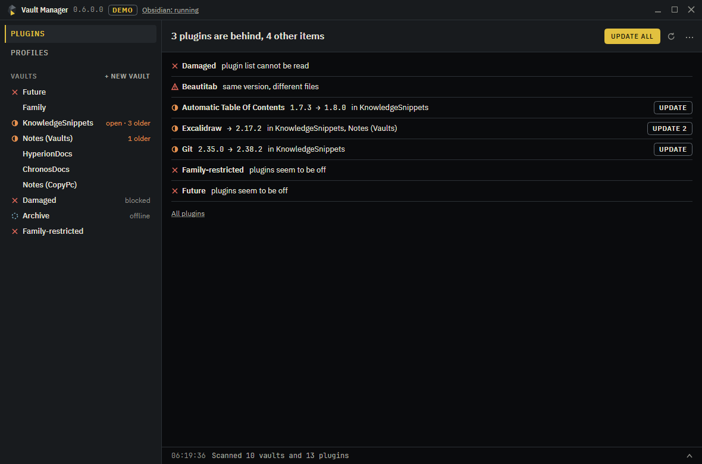
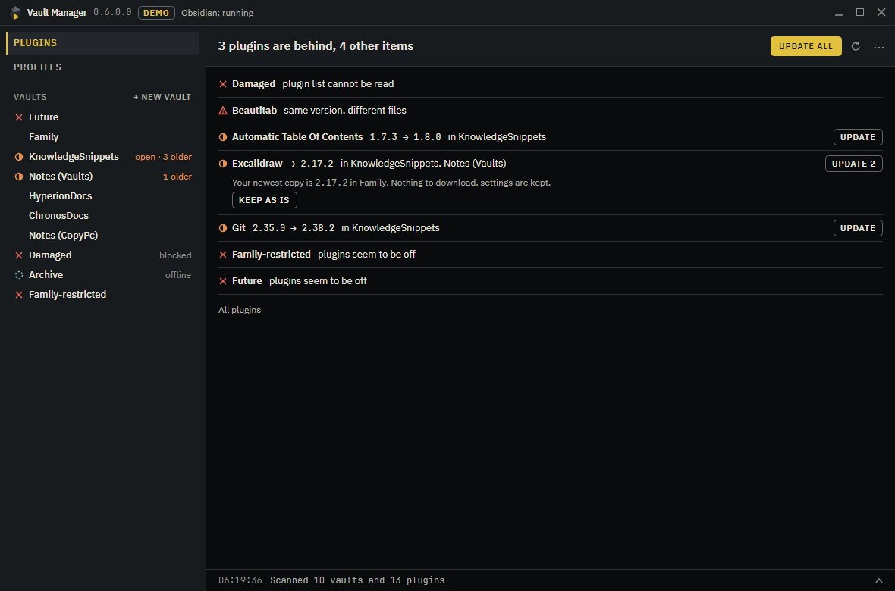
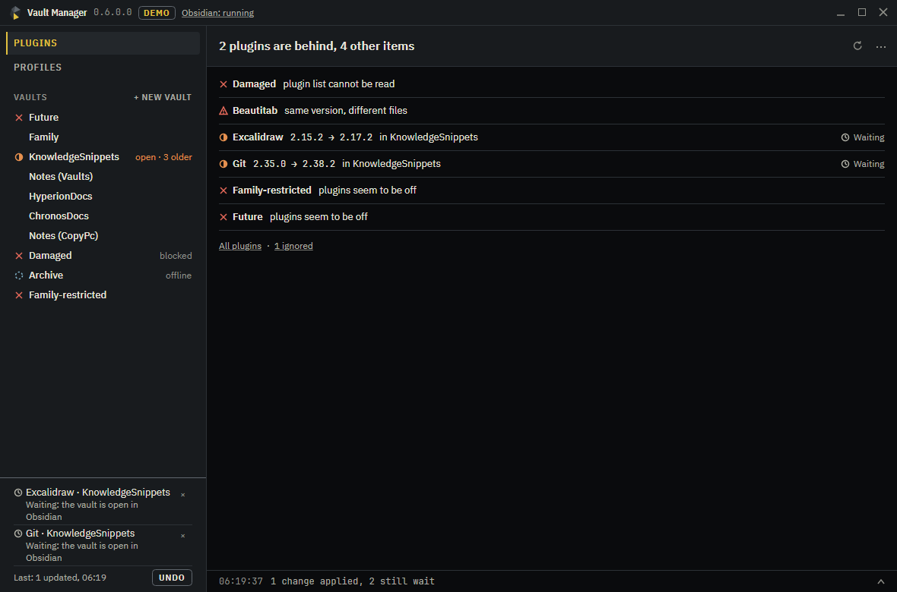
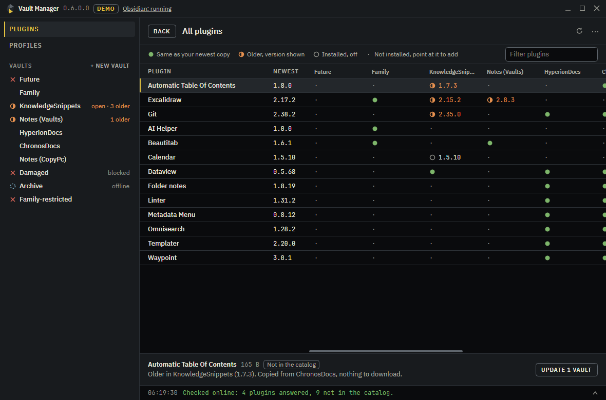
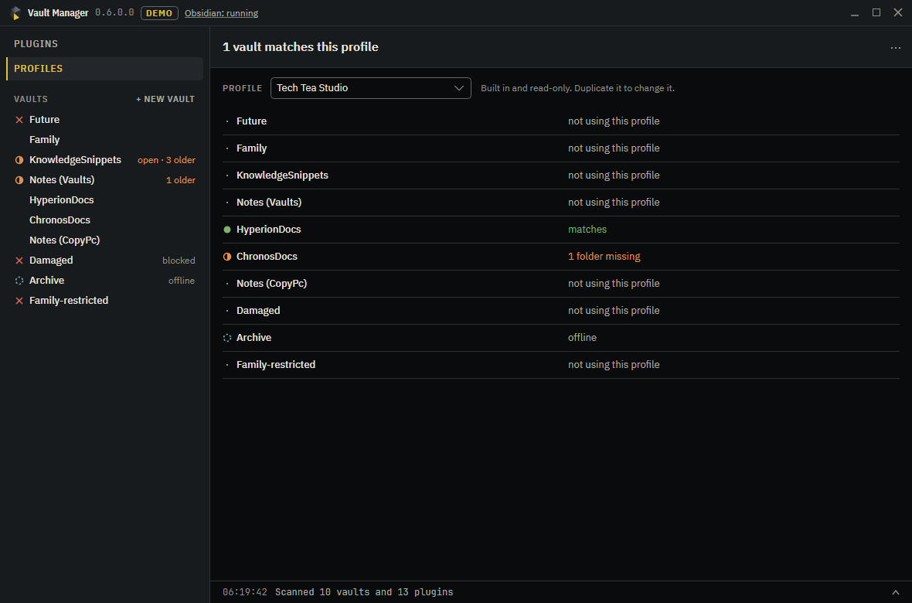
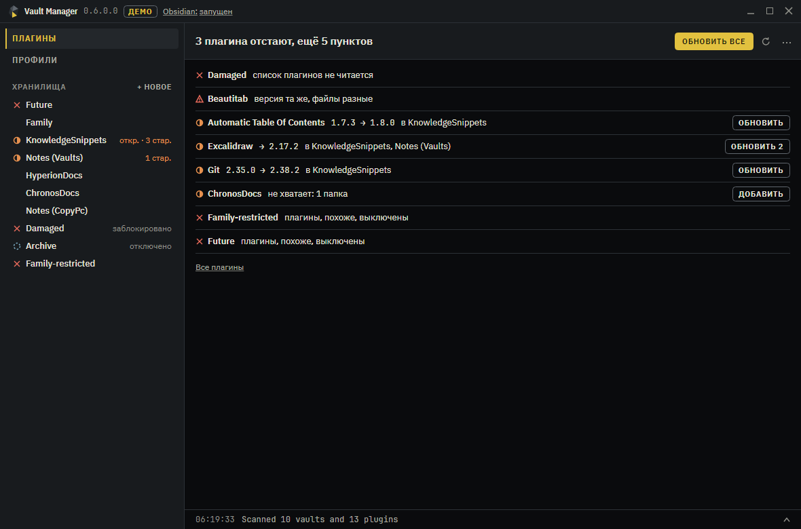

# Vault Manager

Manage Obsidian across all your vaults from one window, with Obsidian closed if you like. See which plugins differ between vaults, bring them in line with one click, set up new vaults from a profile, and undo what you did. Nothing needs installing into a vault.



## What it does

- **Shows what needs attention, one line each.** Plugins that are older in some vaults, vaults with plugins turned off, gaps against a profile, and the same plugin version with different files, which can be a warning sign.
- **Updates in one click, and takes it back in one.** `Update all` brings every older copy up to your newest one. A copy is saved before anything is written, and Undo works even after a restart.
- **Copies before it downloads.** A plugin that exists in another vault comes from there, with no traffic. Downloads from the official catalog happen only on a click, and the size is shown first.
- **Keeps your settings.** An update leaves a plugin's settings alone. Settings holding a key or a token do not travel to other vaults.
- **Leaves open vaults alone.** Changes for an open vault wait until you close it, and changes for an unplugged drive wait for the drive. Then they finish by themselves, even after a restart of the app.
- **Profiles.** A profile is a plain file with plugins, folders, templates and settings. Create, edit, import and export them, check each vault against one, or create a new vault from one.
- **Settings sync.** Copy hotkeys, appearance, editor and plugin settings from one vault to another. It compares against the last time the two vaults agreed, so it knows who changed what and asks only when both did.

## Screenshots

Click a line to see where the newest copy comes from and what happens to its settings:



A vault that is open in Obsidian waits. The rest is already done, and Undo sits in the corner:



Every plugin in every vault, with a version shown only where it is behind:



One plain answer per vault for a profile:



The window also speaks Russian:



The screenshots come from the built-in demo, not from real vaults.

## When not to use it

- To sync notes between devices. Use Obsidian Sync or Git.
- On a phone. It is a Windows desktop app.
- If you want plugins managed from inside Obsidian, try [Extension Hub](https://community.obsidian.md/plugins/extension-hub) or [Vault Extension Sync](https://community.obsidian.md/plugins/vault-plugin-sync).

## Download

Get the self-contained Windows x64 exe from the [Releases page](https://github.com/TechTeaStudio/ObsidianVaultManager/releases). No .NET install is needed.

Try it without touching anything:

```bash
VaultManager-v0.6.0.1-win-x64.exe --demo
```

The demo runs on a throwaway set of vaults and uses no network.

## Where things live

| What | Where |
| :-- | :-- |
| Vault list | Read from `%APPDATA%\obsidian\obsidian.json` |
| Profiles | `%LOCALAPPDATA%\TechTeaStudio\VaultManager\profiles` |
| Journal, undo, waiting changes, decisions | `%LOCALAPPDATA%\TechTeaStudio\VaultManager\vault-manager.db` |
| Saved copies for undo | `%LOCALAPPDATA%\TechTeaStudio\VaultManager\snapshots`, the last 20 operations |

Nothing of the app's own is kept inside a vault.

## Network

The app contacts GitHub only when you choose **Check online** in the `⋯` menu or install a plugin from the catalog. The first time it tells you the catalog size, about 3 MB, before fetching it. No telemetry.

## Build

Building needs the .NET 10 SDK. The app itself also targets .NET 6, 8 and 9.

```bash
dotnet build VaultManager.slnx
```

```bash
dotnet test tests/VaultManager.Tests/VaultManager.Tests.csproj
```

```bash
dotnet run --project src/VaultManager.App/VaultManager.App.csproj -f net10.0 -- --demo
```

The screenshots above are rendered by the test suite. To refresh them, point it at a folder:

```bash
VM_SCREENSHOTS=/d/some/folder dotnet test tests/VaultManager.Tests/VaultManager.Tests.csproj
```

## Release flow

`ci.yml` runs the tests and builds every target on each push and pull request to `product`. `release.yml` publishes the exe when a `v*` tag is pushed, and refuses a tag that does not match the `VERSION` file:

```bash
git tag v0.6.0.1
```

```bash
git push origin v0.6.0.1
```

## License

See [LICENSE.txt](LICENSE.txt). The embedded IBM Plex and JetBrains Mono fonts are under the SIL Open Font License.
